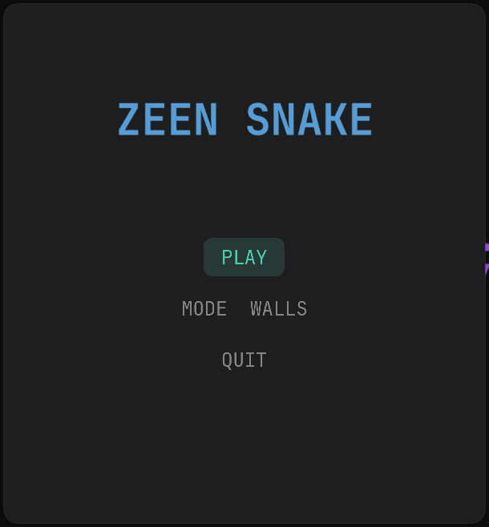
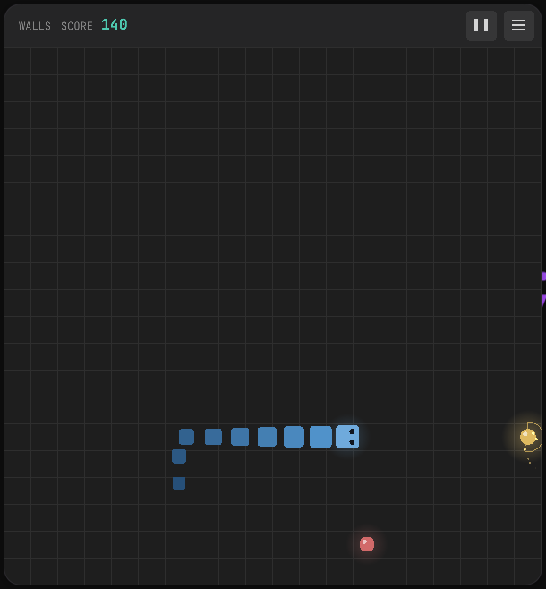

# Snake Game in Zeen
A beautiful snake game implementation in [Zeen](https://zeen-lang.tech). <br/>
Made with love and [zaylib](https://github.com/mealet/zaylib) library.

## Screenshots

<p align="center">
  
  
</p>

## Build & Run
1. Ensure you have installed **Zeen** and its package manager Zora (ships with compiler automatically).
2. Copy this repo:
```bash
git clone https://github.com/mealet/snake-zn
cd snake-zn
```
3. Run the project:
```bash
zora run
```
4. Or build and share binary with others
```bash
zora build -m Release
# will be at `./dist/release/snake`
```
